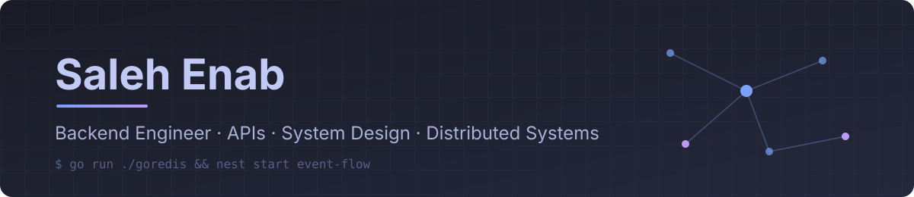

  

  Egypt 
  Backend Developer at <b>Endorphins Art Labs</b> · Technical Supervisor at <b>Eyouth</b> 
  B.Sc. Computer &amp; Control Systems Engineering, Mansoura University

  
  
  
  
  

---

### 💼 Experience

- **Endorphins Art Labs** · Backend Developer: multi-tenant APIs on PostgreSQL, Redis and BullMQ serving 5,000+ client systems; k6 load testing, caching and deployment pipelines.
- **Eyouth** · Technical Supervisor: internal platforms for 400+ coordinators and 2,000+ sessions, replacing Excel-based workflows.

---

### 🚀 Building

- **[goredis](https://github.com/Saleh-enab/goredis)**: a Redis clone in Go with a custom RESP parser, concurrent TCP server and AOF/RDB persistence.
- **[Event-Flow](https://github.com/Saleh-enab/Event-Flow)**: event management backend on NestJS microservices with an API gateway, Kafka and Redis.
- **F&B Ordering System**: high-traffic ordering platform for Roshdy 3al Saree3 and Bremer, with Paymob payments and background jobs.
- **Operations Management System**: ops platform for the DECI project serving 60,000+ students and 5,000+ sessions.

---

### 🌍 Open source

- **Orangu**: [#291](https://github.com/mnemosyne-systems/orangu/pull/291) Docker/Podman deployment support in a single image
- **Orangu**: [#271](https://github.com/mnemosyne-systems/orangu/pull/271) Prometheus metrics endpoint with configurable port
- **Orangu**: [#308](https://github.com/mnemosyne-systems/orangu/pull/308) Configurable model download permissions
- **Orangu**: [#309](https://github.com/mnemosyne-systems/orangu/pull/309) Hugging Face URL handling
- **Orangu**: [#310](https://github.com/mnemosyne-systems/orangu/pull/310) Git commit identification in builds

---

### ✍️ Writing

- [Building a Redis Clone in Go](https://dev.to/saleh_enab/building-a-redis-clone-in-go-22)

---

### 🛠️ Stack

---

  

<picture>
  <source media="(prefers-color-scheme: dark)" srcset="https://raw.githubusercontent.com/Saleh-enab/Saleh-enab/output/snake-dark.svg" />
  
</picture>

Certificates: <a href="https://learn.kodekloud.com/user/certificate/dd3e1abc-a5df-4017-ab8b-1bd91415cc55">Docker Fundamentals (KodeKloud)</a> · <a href="https://www.hackerrank.com/certificates/59f0b3e676ba">REST API Intermediate (HackerRank)</a> · <a href="https://www.udemy.com/certificate/UC-43acea8c-ebc9-402d-ab22-e2237c383141/">Back End Fundamentals (Udemy)</a>

